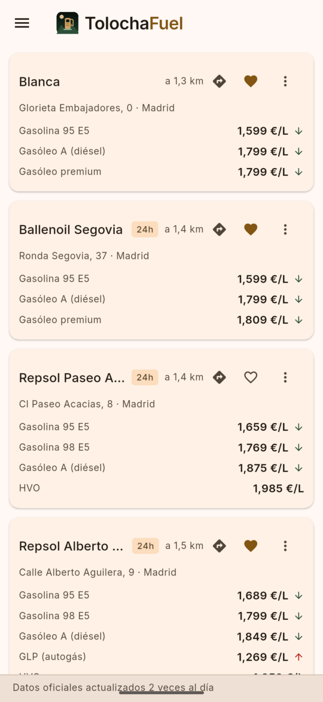
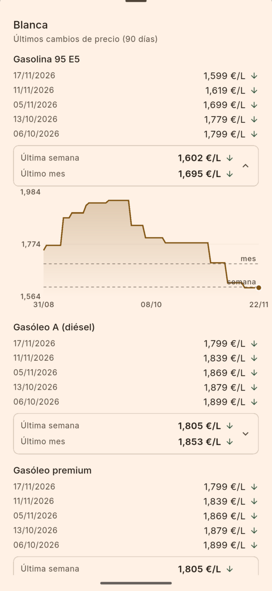
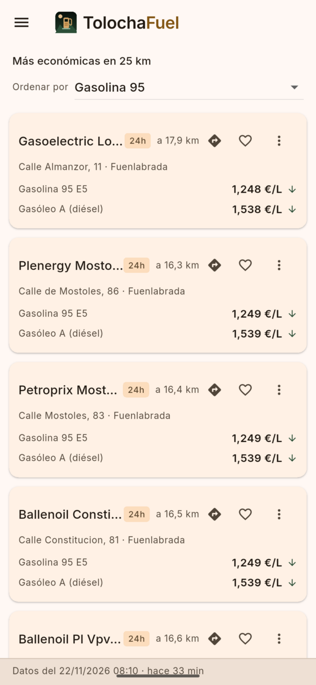
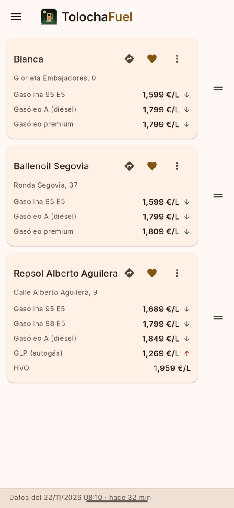
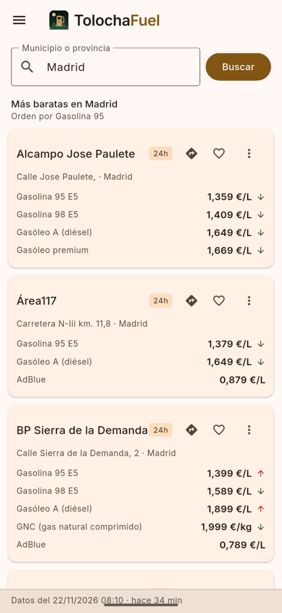
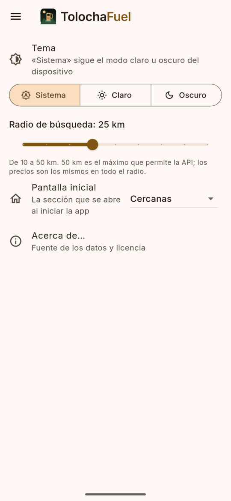
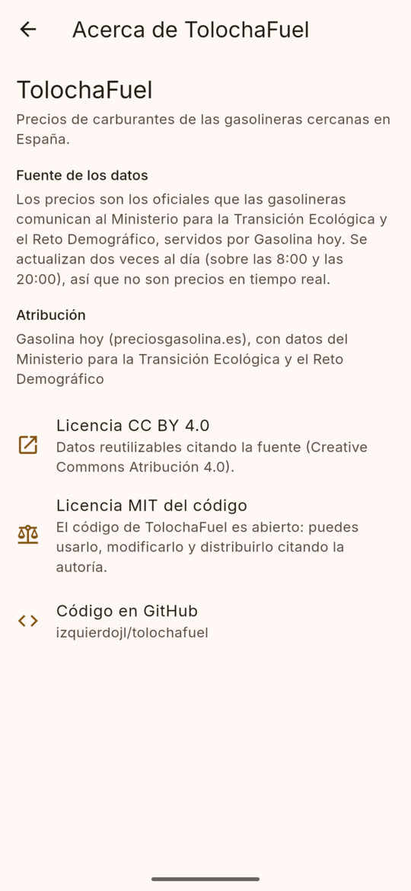
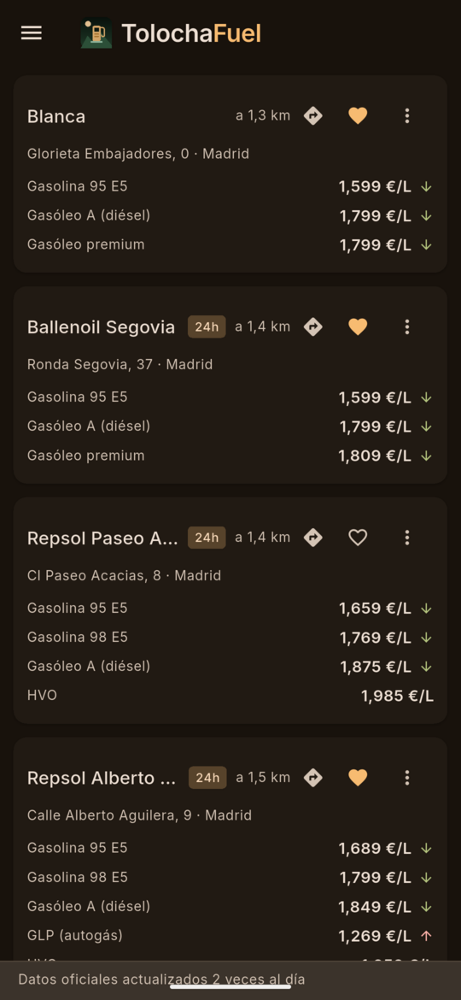
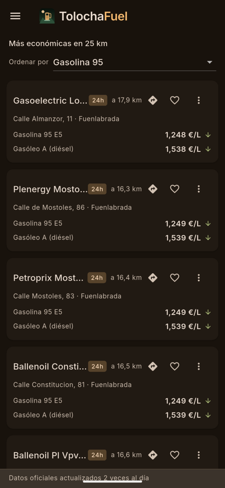

  

<h1 align="center">TolochaFuel</h1>

<em>Los precios de los carburantes cercanos, claros y sin rodeos.</em>

  <a href="https://github.com/izquierdojl/tolochafuel/releases/latest"><strong>Descargar la última versión</strong></a>

TolochaFuel es una aplicación para Android, Windows y Linux que te dice dónde repostar
más barato cerca de ti. Abre la app, permite que te localice y consulta en segundos las
gasolineras de alrededor, ordenadas por distancia y con los precios oficiales de cada
carburante. Si prefieres no usar la ubicación, busca por municipio o provincia.

Sin cuentas, sin registro y sin seguimiento: tus favoritos, tus ajustes y tus alias se
quedan en tu dispositivo.

## Qué puedes hacer

- **Ver las gasolineras cercanas** ordenadas por distancia, con precios por carburante y
  el aviso de 24 horas.
- **Guardar favoritas** y ordenarlas como quieras; conservan su precio y su histórico.
- **Activar avisos de precio** en tus favoritas y recibir una notificación cuando cambien,
  con acceso directo a la ficha de la estación.
- **Buscar por municipio o provincia** cuando no quieras compartir la ubicación, también
  en el escritorio.
- **Comparar las más económicas** por gasolina 95, 98, gasóleo A, gasóleo premium, GLP,
  GNC o por la media de sus precios.
- **Consultar el histórico** de los últimos 90 días con gráfico, variación y medias
  semanales y mensuales.
- **Navegar a la gasolinera** con la app de mapas del dispositivo, o con Google Maps en el
  escritorio.
- **Poner alias** a las estaciones para reconocerlas de un vistazo.
- **Elegir tema claro u oscuro**, o dejar que siga el del sistema.

## Capturas

> Imágenes ilustrativas de la app en Android. Los precios cambian dos veces al día.

| Cercanas | Histórico | Más económicas |
| :---: | :---: | :---: |
|  |  |  |
| **Favoritas** | **Buscar** | **Configuración** |
|  |  |  |
| **Acerca de** | **Cercanas en oscuro** | **Más económicas en oscuro** |
|  |  |  |

## Descárgala

La última versión se publica en [GitHub Releases](https://github.com/izquierdojl/tolochafuel/releases/latest)
con enlaces estables:

| Plataforma | Formato | Descarga |
| --- | --- | --- |
| Android | APK | [`tolochafuel.apk`](https://github.com/izquierdojl/tolochafuel/releases/latest/download/tolochafuel.apk) |
| Windows x64 | ZIP portable | [`tolochafuel-windows-x64.zip`](https://github.com/izquierdojl/tolochafuel/releases/latest/download/tolochafuel-windows-x64.zip) |
| Linux x64 | tar.gz portable | [`tolochafuel-linux-x64.tar.gz`](https://github.com/izquierdojl/tolochafuel/releases/latest/download/tolochafuel-linux-x64.tar.gz) |
| Linux x64 | AppImage | [`tolochafuel-linux-x64.AppImage`](https://github.com/izquierdojl/tolochafuel/releases/latest/download/tolochafuel-linux-x64.AppImage) |
| Linux x64 | Flatpak | [`tolochafuel-linux-x64.flatpak`](https://github.com/izquierdojl/tolochafuel/releases/latest/download/tolochafuel-linux-x64.flatpak) |

Android, Windows y Linux son las plataformas disponibles. iOS, la web y la Play Store
están aplazados. En [instalación](docs/instalacion.md) tienes los pasos completos,
incluido el aviso de SmartScreen de Windows y los comandos de Linux.

## Datos y transparencia

Los precios son los oficiales que las gasolineras comunican al **Ministerio para la
Transición Ecológica y el Reto Demográfico** y que publica **Gasolina hoy**. Se actualizan
**dos veces al día** (sobre las 8:00 y las 20:00), así que no son precios en tiempo real.

> Gasolina hoy (preciosgasolina.es), con datos del Ministerio para la Transición Ecológica
> y el Reto Demográfico

Los datos se reutilizan bajo [CC BY 4.0](https://creativecommons.org/licenses/by/4.0/).
La app muestra la atribución y la frescura en **Configuración → Acerca de…**. Más detalle
en [datos y frescura](docs/datos.md).

## Documentación

| Página | Contenido |
| --- | --- |
| [Uso](docs/uso.md) | Qué hace la app, pantalla a pantalla |
| [Instalación](docs/instalacion.md) | Descarga y pasos en Android, Windows y Linux |
| [Datos y frescura](docs/datos.md) | Fuente, actualizaciones, límites y atribución |
| [Arquitectura](docs/arquitectura.md) | Capas, estado, caché y plataformas |
| [Desarrollo](docs/desarrollo.md) | Entorno, comandos, CI, release y capturas |
| [Licencia](docs/licencia.md) | MIT para el código y CC BY 4.0 para los datos |

El índice completo está en [docs](docs/README.md).

## Licencia

El código es **MIT**: puedes usarlo, modificarlo y distribuirlo citando la autoría. Los
datos conservan la **CC BY 4.0** de su fuente. Consulta [LICENSE](LICENSE) y
[licencia](docs/licencia.md).
