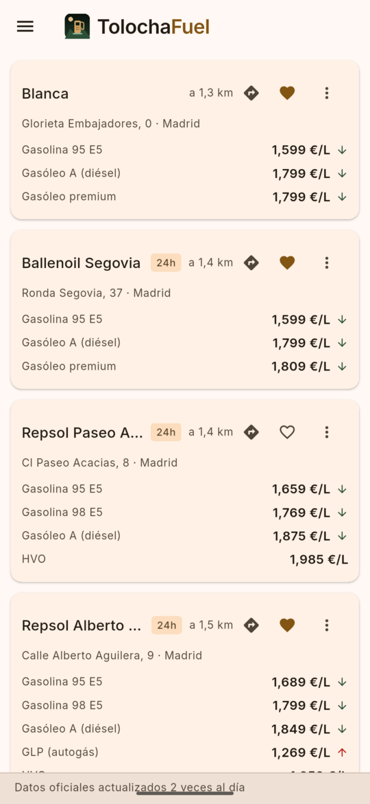
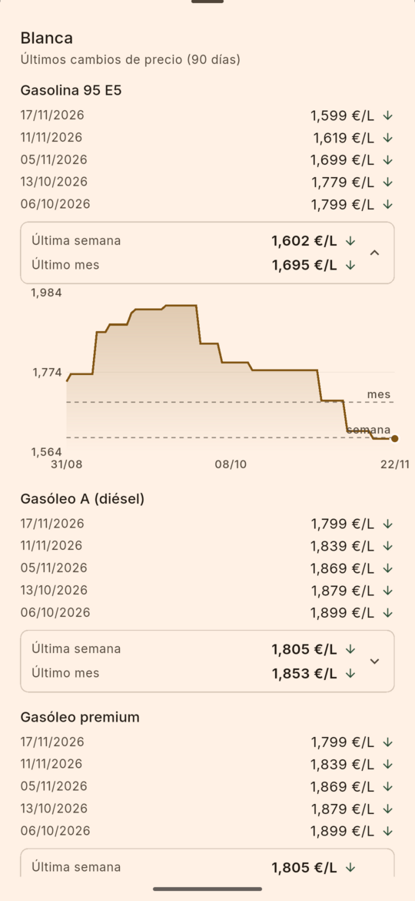
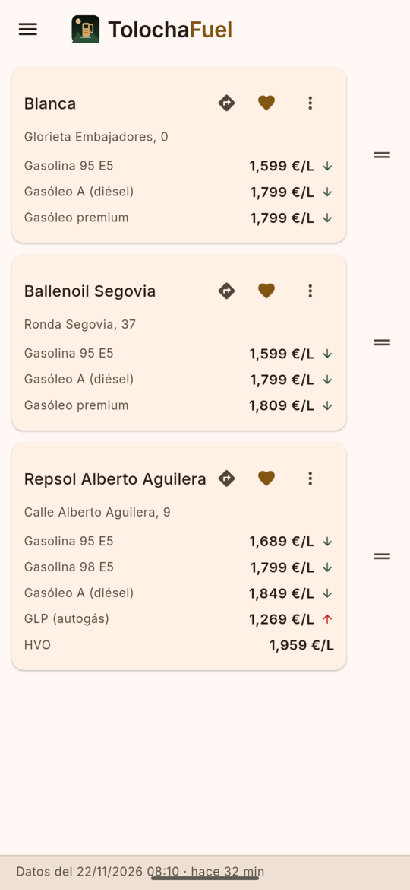
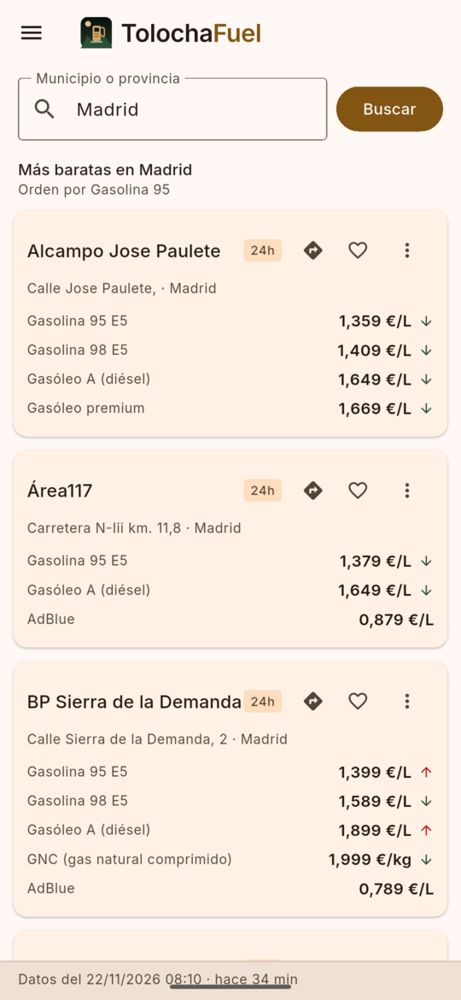
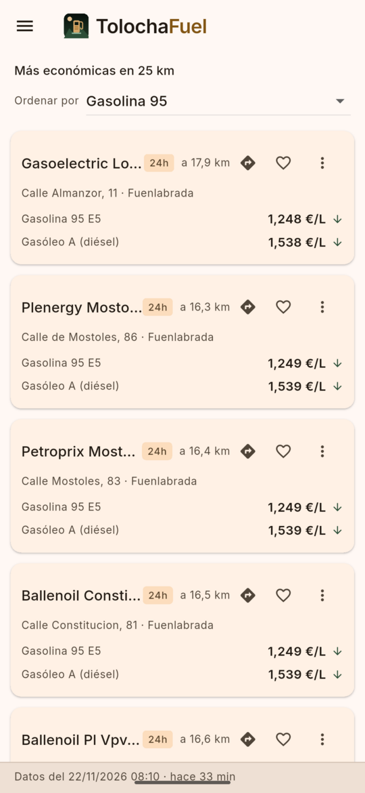
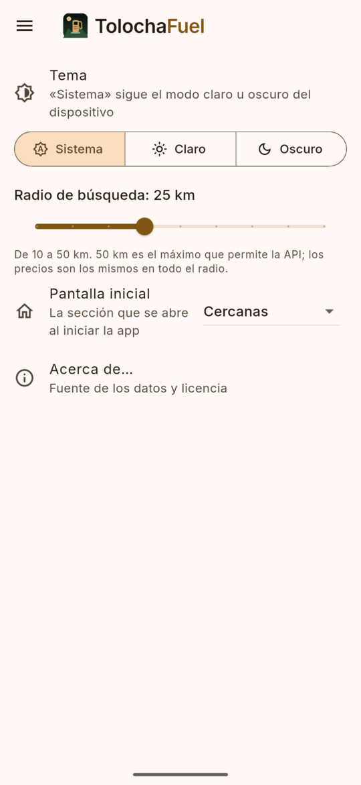
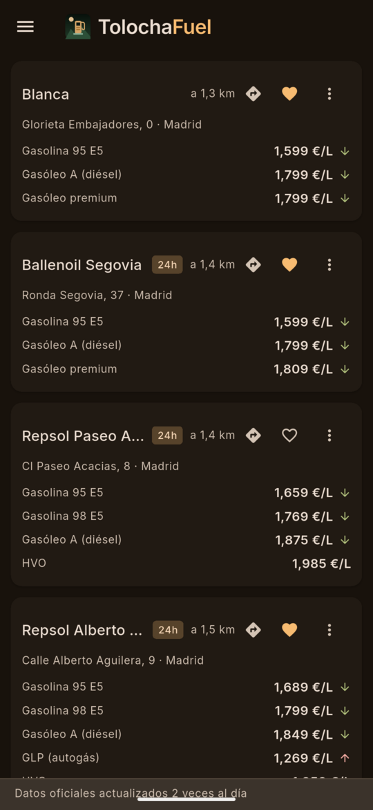
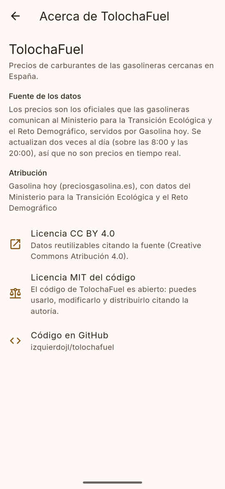

# Uso de TolochaFuel

> [← Volver al README](../README.md)

TolochaFuel te ayuda a encontrar los carburantes más baratos cerca de donde estás o en el
municipio que elijas. Abre la app, permite que te localice y consulta la lista: cada
gasolinera muestra su distancia y los precios de los carburantes disponibles.

> Las capturas de esta página son ilustrativas. Los precios cambian dos veces al día
> (sobre las 8:00 y las 20:00) y no son en tiempo real.

## Cercanas

La pantalla inicial muestra las gasolineras dentro del radio configurado, ordenadas de
menor a mayor distancia. Cada tarjeta incluye el nombre, la dirección, la distancia, los
precios por carburante, la marca de 24 horas cuando corresponde y el pie con la última
actualización de los datos.

Desde la tarjeta puedes:

- Marcar o desmarcar la gasolinera como favorita con el corazón.
- Abrir la app de mapas con el botón de navegación.
- Poner un alias para reconocerla mejor (menú de tres puntos).
- Tocar una fila de precio para ver su histórico.

Si no hay gasolineras en el radio, la app te sugiere ampliarlo en Configuración o buscar
otro municipio. Si la ubicación está denegada o no existe (escritorio), muestra un aviso y
te remite a Buscar.

## Histórico y tendencia

Al tocar un precio se abre una hoja con el histórico de los últimos 90 días: gráfico,
variación, últimas subidas y bajadas y medias semanales y mensuales. Las flechas de la
tarjeta resumen la tendencia del carburante.

## Favoritas

Las favoritas se guardan solo en tu dispositivo y se ordenan como quieras: mantén pulsada
una tarjeta o usa el asa de arrastre. Cada favorita conserva su precio actualizado, su
alias y su acceso al histórico.

### Avisos de precio

Cada favorita tiene un icono de campana junto al corazón, sin una fila adicional en la
tarjeta. La campana se ve rellena cuando el aviso está activo y contorneada cuando está
apagado, con el mismo tratamiento que el corazón. Al activarla, la app guarda una foto de
los precios actuales, muestra un diálogo con el resultado y te avisa cuando cambian en una
actualización posterior. El aviso muestra los carburantes afectados, el precio anterior y
el nuevo, y la fecha de los datos; al tocarlo se abre la ficha de la estación con sus
precios, su histórico y los accesos de navegar, favorito y campana.

- Solo se avisa de estaciones favoritas. Si desmarcas una, la campana se apaga y se borra
  su base de precios; si vuelves a marcarla, empieza apagada.
- En Android 13 o superior se pide permiso de notificaciones la primera vez. Si lo
  deniegas, la campana no se activa y la app explica cómo concederlo.
- En Android, la app programa una comprobación con WorkManager después de cada
  actualización y también comprueba al abrir o reanudar. El sistema puede retrasarla por
  Doze o por la gestión de batería del fabricante; no es tiempo real. Si fuerzas la
  detención de la app, los avisos se recuperan al volver a abrirla.
- En Windows y Linux se intenta una notificación local; si el entorno no la admite, el
  aviso aparece dentro de la app. En escritorio no se prometen avisos con la app cerrada.
- Los datos se actualizan dos veces al día y no son tiempo real. La primera comprobación
  tras activar la campana solo crea la base y no notifica; si no hay conexión, se crea en
  la siguiente comprobación correcta.

## Buscar por municipio o provincia

Si no quieres usar la ubicación, escribe un municipio o una provincia en **Buscar** y
elige uno de los resultados. La app muestra las estaciones más económicas de ese
territorio con los mismos precios y la misma frescura.

## Más económicas

Esta sección ordena las estaciones del radio por el carburante que elijas, o por la media
de sus precios. Cambia el criterio en el selector para comparar gasolina 95, gasolina 98,
gasóleo A, gasóleo premium, GLP, GNC o la media.

## Configuración

En **Configuración** puedes cambiar el tema (Sistema, Claro u Oscuro), el radio de
búsqueda (de 10 a 50 km), la pantalla que se abre al iniciar y el criterio de Más
económicas. También puedes consultar la información de la app en «Acerca de».

El tema oscuro está pensado para usarse de noche o con el modo oscuro del sistema:

## Acerca de y datos

**Configuración → Acerca de…** explica de dónde salen los precios, cuándo se actualizan y
qué licencia tiene cada cosa: los datos son CC BY 4.0 con atribución a Gasolina hoy y al
Ministerio para la Transición Ecológica y el Reto Demográfico, y el código es MIT.

## Navegación y avisos

Los botones de navegación abren la aplicación de mapas del dispositivo (en el escritorio,
Google Maps en el navegador). Si no hay ninguna app de mapas disponible, la app avisa con
un mensaje en español. Los errores de red o de la API también se muestran con un mensaje
claro y un botón para reintentar.

Los avisos de precio se activan por favorito con la campana de Favoritas. La app pide
permiso de notificaciones solo cuando hace falta y no crea cuentas ni envía datos a un
servidor propio: la comprobación se hace directamente contra la API pública.

## Privacidad

No hay cuentas, ni registro, ni seguimiento. La ubicación se usa solo para ordenar las
gasolineras cercanas y no se envía a ningún servidor propio. Favoritos, ajustes y alias
quedan guardados en el dispositivo.
